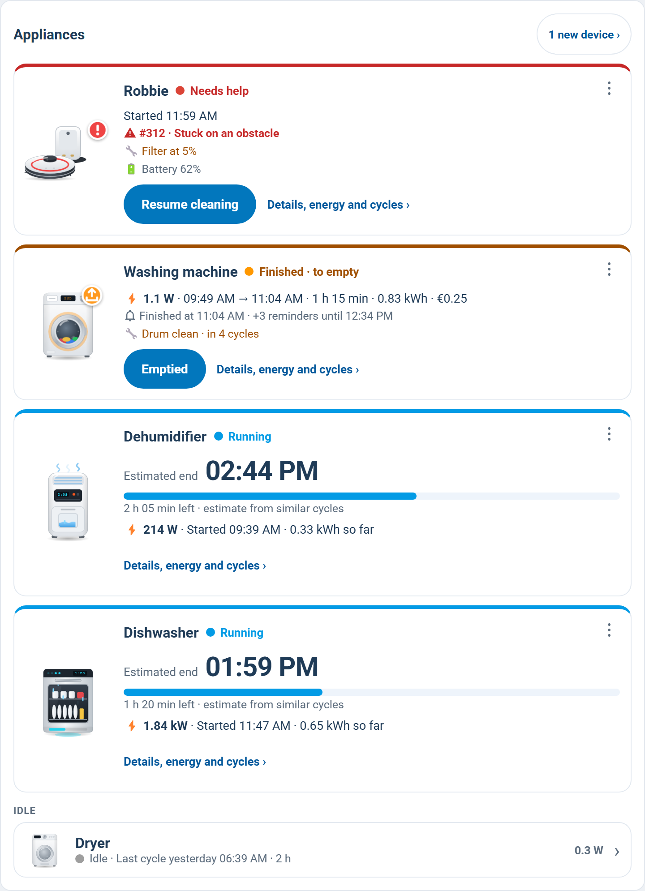
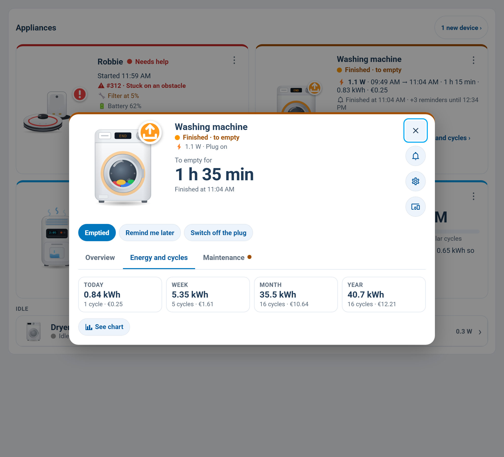
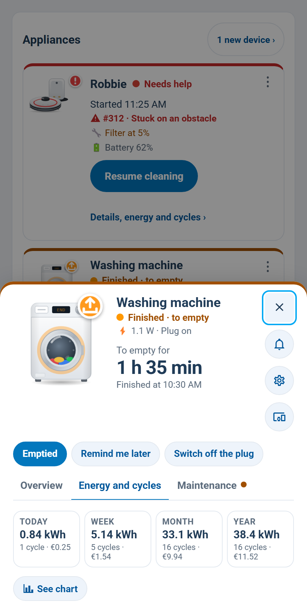

# supernotify-appliances-card

[← SuperNotify Cards](../../README.md) · [Common options](../configuration.md)

The appliances [Appliance Autonotify](https://github.com/rhizomatics/appliance_autonotify) watches -
washing machine, dishwasher, dryer, robot vacuum, 3D printer - with what each one is doing, its
buttons, and its energy and cycles. In the [dashboard strategy](../dashboard.md) it is the
**Appliances** view (in Italian *Elettrodomestici*), shown only when Appliance Autonotify has at least one appliance.



```yaml
type: custom:supernotify-appliances-card
price_per_kwh: 0.30        # optional: costs in € (or your currency) - never shown without a price
```

## What it shows

**First what asks for something, then what is running.** Each of these is a card of its own: the
illustration, the name, a coloured dot - blue running, orange finished and not emptied yet, red
stuck or in error, grey idle or off - one line with the last (or current) cycle - start → end,
duration, kWh and cost, after the power now (⚡ 1850 W, with a power sensor) - and **one** main button:

| State | Main button | What it does |
|---|---|---|
| Finished, to empty | **Emptied** (Done for a vacuum or a printer) | the very **Finished** button of Autonotify's notification: the same `mobile_app_notification_action` event, so the reminders stop and the notification goes away on the phones |
| Robot vacuum stuck | **Resume cleaning** | `vacuum.start` |
| Running | - | the estimated end in big, a bar and the time left |

The rest is in the **⋮** menu: **Switch off the plug** (when there is a plug, it is on and the
appliance is not running - Autonotify's own Switch Off button), **Remind me later** (its Remind
Later button), Details and Settings. A finished appliance also says when it finished and how many
reminders followed: "Finished at 09:38 · +3 reminders until 11:08".

The estimated end comes from the appliance itself when it reports one (remaining time or finish
time, e.g. Home Connect or Bambu Lab), else from the average of its cycles of the same kind: the
cycles are split into short and long by their duration, and one that has run longer than the short
ones is taken for a long one.

**Idle** below: one row per appliance with its icon, its last cycle, the power now at the right
(standby, e.g. 0.4 W) and an arrow to the details.
A robot vacuum also shows its battery, its error (number and description) and any consumable
(brush, filter, mop) under 10%.

**New appliances** found by Autonotify and not set up yet are not on the page: a badge "2 new
devices" (administrators) opens the integration's page instead.

**One appliance first.** `?device=<device id or entry id>` in the URL of the view puts that
appliance first, outlined in blue for five seconds - e.g. from the tap on a notification.

## Details panel

A tap on an appliance's drawing or on an idle row opens it on the **Overview** tab; "Details, energy
and cycles ›" on a card opens the second tab directly - a dialog on a computer, a sheet from the
bottom on a phone.

**Overview**: the drawing, big, and the state; the cycle under way (estimated end, time left) or the
last one (start → end, duration, kWh, cost) and the average; the notifications already sent; what the
device says - the power now and the plug (with **Switch off the plug**), a robot's battery, error and
consumables, a printer's progress, layer and temperatures; the buttons that make sense now
(**Emptied**, **Remind me later**, **Resume cleaning**) and a link to the device in Home Assistant.

The second tab - **Energy and cycles**, **Cleanings** for a robot, **Prints** for a printer:




- the state and the power now;
- **Today / Week / Month / Year**: kWh, cycles and cost;
- the energy of each cycle this month, blue for the short ones, purple for the long ones, orange
  for an unusual one (more than three times the median duration - a machine left on for 22 hours);
- the averages of short and long cycles, and the latest cycles in a table;
- **Appliance notifications** opens the archive card filtered on this appliance (on this page or
  on the Archive view), **Settings** the appliance's page in Appliance Autonotify.

## Where the data comes from

Appliance Autonotify 0.9 has no entities of its own, and a card cannot read the options of a
config entry, so:

- **the appliances** are its config entries (`config_entries/get`), less the "Automatic discovery"
  one and the ignored or disabled ones;
- **the plug, the vacuum or the device** of each is found by the entry's name: the power sensor of
  a device named like it ("Lavatrice" → the "Presa Lavatrice" plug), never an estimated one
  (Powercalc, template, ...); the plug's switch on the same device; for a robot vacuum the device
  with that name and a `vacuum` entity. Set them yourself with `appliances:` when the names differ;
- **running, finished, emptied** is what Autonotify itself sent through SuperNotify, read back from
  the archive: the start, the end, each reminder and the Finished button all carry its tag
  `appliance_<entry id>`. The thresholds are Autonotify's own, so the card agrees with the
  notifications. Without SuperNotify's archive the power alone decides;
- **cycles and energy** come from the recorder's statistics of the power sensor - 5-minute ones for
  the last 10 days, hourly ones before that (kept in this browser and never read again). Cycles
  older than 10 days are therefore counted by the hour. The power sensor needs
  `state_class: measurement`, as plugs have.

The buttons fire a Home Assistant event, which only an administrator can do: for anyone else the
card shows no Emptied / Remind button, and Switch off the plug switches the plug directly.

## Options

| Option | Required | Description |
|---|---|---|
| `price_per_kwh` | no | price of a kWh, for the costs (none without it or `price_entity`) |
| `price_entity` | no | a sensor or input_number with the price, instead of a fixed one |
| `illustrations` | no | `false` always uses the mdi icon (default: the card's own drawing of the appliance) |
| `animations` | no | `false` keeps the drawings still (default: they move - the drum turns, the robot's brushes spin) |
| `robot_dock` | no | `false` draws a robot vacuum without its charging dock (default: with it); `dock:` per robot under `appliances:` |
| `show_new` | no | `false` hides the badge of the new appliances found |
| `hide` | no | entry ids or names to leave out |
| `appliances` | no | per appliance (by entry id or name), what the card cannot find or read - see below |
| `device` | no | one device only (its name or entry id): its overview and history right in the card, with no list and no dialog - a control centre for that device |
| `devices` | no | devices added by hand, next to Autonotify's - see [Devices added by hand](#devices-added-by-hand) |
| `title`, `intro`, `style`, `show_version` | no | as on every card |

```yaml
appliances:
  Lavatrice:
    power_entity: sensor.presa_lavatrice_power
    switch_entity: switch.presa_lavatrice
    threshold: 5          # W above which it runs (cycles in the panel; default 5)
    grace_period: 120     # s below the threshold before a cycle ends (default 300)
    min_duration: 60      # s: shorter ones are not cycles (default 300)
    switch_off_button: false   # no "Switch off the plug" in the menu
    switch_on_button: false    # no "Switch on the plug" when it is off
  Bruno:
    device_id: 1889e4c8a6963028993b7735031f451d
    dock: false           # this robot has no charging dock
  A1:
    remaining: sensor.a1_tempo_rimanente
    energy_today: sensor.a1_energy_today   # your own sensors, shown instead of the card's own sums
```

`threshold`, `grace_period` and `min_duration` are only for the cycles in the panel: whether an
appliance is running or finished is Autonotify's own decision. Set them as in Autonotify when its
cycles and the card's disagree.

## One device per card

```yaml
type: custom:supernotify-devices-card
device: Lavatrice
price_entity: input_number.costo_energia_kwh
```

The card shows that device alone - the drawing, the state, the **Overview** and the history tabs,
the buttons - as the details panel does, inside the card. It works for an Autonotify appliance and for a
device added by hand (`device: Deumidificatore` with `devices:` below). Since 0.2.0 the card is
`custom:supernotify-devices-card`; `custom:supernotify-appliances-card` keeps working.

## Devices added by hand

Anything Autonotify does not watch - a dehumidifier, a heater, a fridge - can be added under `devices:`,
with the same keys as `appliances:`. It gets the same drawing (by `type`, or from its name), overview and
history; it runs while its power is above `threshold` (and through the pauses of its cycle, by
`grace_period`); there is no "to empty" and no reminders, which come from Autonotify.

```yaml
devices:
  - name: Deumidificatore
    type: dehumidifier                       # else from the name; a drawing for the known types
    power_entity: sensor.presa_deumidificatore_power   # needs state_class: measurement for the history
    switch_entity: switch.presa_deumidificatore
    threshold: 20
    info:                                    # shown in the overview
      - sensor.deumidificatore_tank
      - sensor.deumidificatore_current_humidity
```

`info:` works under `appliances:` too. A robot (`vacuum:`) or a device with a state of its own
(`device_id:`) can be added the same way.

## Changing things and buttons of your own

Every row of the overview that comes from an entity - `info:`, a robot's consumables, a printer's
temperatures - opens Home Assistant's own dialog of that entity when tapped: there you change a time, a
level, a number or a switch, as anywhere in Home Assistant. An `info:` row can have a name of its own:
`- { entity: number.bruno_water_flow_level, name: Water }`.
Two entities can share a row - `- { name: Mornings, entities: [input_datetime.from, input_datetime.to] }` shows
"06:30 – 08:00", each tappable. What can be changed (times, numbers, selects, switches, automations) folds
under **⚙️ Settings** below the readings, so the card stays short.

An appliance whose power sensor tells nothing (an estimated one stuck at 0 W) can take its cycles from a
state instead: `cycle_entity: sensor.oven_appliance_state` counts each "Running" as a cycle, from Home
Assistant's history.

`actions:` (under `appliances:` or `devices:`) adds buttons next to the others:

```yaml
appliances:
  Bruno:
    actions:
      - entity: script.clean_kitchen              # a script runs, a button is pressed,
        name: Kitchen                             # a switch / input_boolean / automation is toggled,
        icon: mdi:silverware-fork-knife           # anything else opens its dialog
      - name: Empty the bin
        tap_action:                               # or any tap_action, as in Home Assistant's cards:
          action: perform-action                  # perform-action, toggle, more-info, navigate, url
          perform_action: button.press
          target: { entity_id: button.bruno_empty_dustbin }
        confirmation: true                        # asks first (or { text: "..." })
```

When the plug is off, **Switch on the plug** turns it on (the plug's own switch: Autonotify has no
button for it); `switch_on_button: false` hides it.

## Last 7 days

The history tab has one row a day for the last 7 days - cycles (cleanings, prints), time, energy and
cost, or area, or filament - next to Today / Week / Month / Year.

## Illustrations

Each appliance has a drawing of its own, made for this card and driven by its state (no other card
needed): washing machine (and washer-dryer), dryer, dishwasher, oven, 3D printer, boiler (water heater), dehumidifier, and a robot vacuum
with or without its charging dock. Other types keep an mdi icon.

| State | What the drawing shows |
|---|---|
| Off / idle | still, faded when off |
| Running | it moves (drum, water, heat, spray, print head, brushes); the display shows the time left and a ring or bar the progress, when the appliance or the cycles average give them - else "ON" |
| Paused | still, grey ⏸ badge, display "PAU" |
| Finished, to empty | orange badge with an arrow out of a tray, display "END" |
| ... reminder already set | the badge turns into a clock (after **Remind me later** on this card) |
| ... for over 2 hours | the badge and the display pulse harder |
| Needs help | red "!" badge, display "Err", a shake |
| Robot on its dock | charging: green light and bolt on the dock; going back: it moves to the dock |

A robot has no "to empty" badge: when it is done it goes back to its dock.
The same four badges on every appliance, so they read the same everywhere. Idle appliances show the
drawing small in their row. A tap on a drawing opens the details panel. The movements stop while the
card is off screen, with **Movements of the drawings** (`animations`) off, and with the system's
"reduce motion" setting. Screen readers read "<name>: <state>".

## Robot vacuum and 3D printer details

A robot has no power sensor, so its panel shows cleanings in place of energy: Today / Week / Month /
Year with the cleanings, the time and the m² from the robot's own totals (their long-term statistics -
`total_stats_cleanings`, `total_stats_time`, `total_stats_area` on Ecovacs), each cleaning this month
as a bar (its duration), the average, and the latest cleanings with their area. The single cleanings
come from the vacuum's state history (cleaning, returning, paused), as far back as the recorder keeps it.

An appliance with a state of its own (a 3D printer, a Home Connect appliance) has the same panel with
its prints or cycles, from the history of that state (Bambu Lab `print_status`, Home Connect
`operation_state`): duration, filament in grams (`print_weight`) and the print's name, a failed print in
orange. Its hours come from its own counter (`total_usage_hours`) when it has one, else from the runs read.
