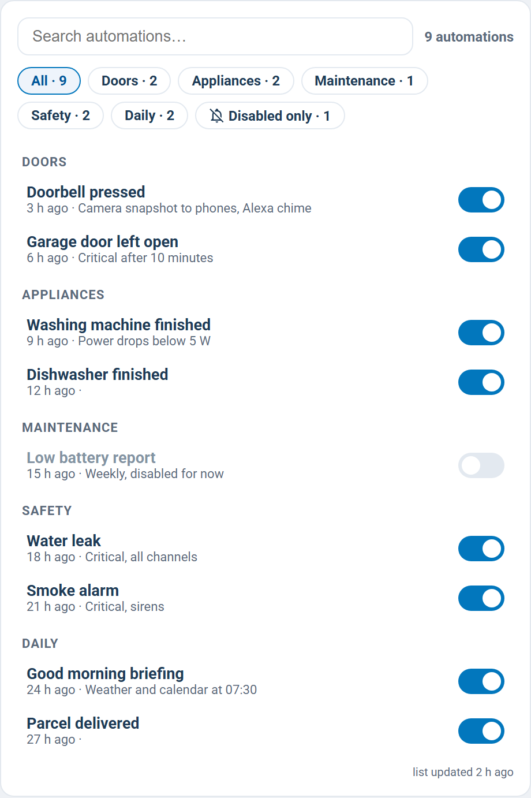

# supernotify-automations-card

[← SuperNotify Cards](../../README.md) · [Common options](../configuration.md)

Live list of the automations that notify via `notify.supernotify`: search,
category filters, a "🔕 disabled only" toggle, state and "last triggered",
enable/disable, tap a row for the automation's own more-info dialog.



Home Assistant does not expose the config of YAML/package automations (they
have no `id`), so discovery is hybrid: [`tools/genera_vista_automazioni.py`](../../tools/genera_vista_automazioni.py)
(included in this repo, run on the HA host or wherever it can read your
config directory) scans `automations.yaml`/`packages/*.yaml`, finds the
ones calling `notify.supernotify` and writes a JSON manifest to
`config/supernotify/automations.json`. A `command_line` sensor puts that list
in its attributes and the card reads it from there, layering everything live
on top of it (state, last_triggered, enable/disable). Edit the `HA_CONFIG_DIR`
and `CATEGORIES` constants at the top of the script for your own setup
before running it, and rerun it whenever automations are added, removed or
renamed — the card itself never scans anything.

### Setup

1. Run the script once: it creates `config/supernotify/automations.json`.
2. Add the sensor to `configuration.yaml` (or a package) and restart Home Assistant:

```yaml
command_line:
  - sensor:
      name: SuperNotify automations
      unique_id: supernotify_automations
      command: "cat /config/supernotify/automations.json"
      value_template: "{{ value_json.automations | count }}"
      json_attributes:
        - generated
        - automations
      scan_interval: 3600

recorder:
  exclude:
    entities:
      - sensor.supernotify_automations
```

The sensor re-reads the file every hour; after rerunning the script you can
refresh it at once with `homeassistant.update_entity` on
`sensor.supernotify_automations`. The recorder exclusion keeps the list (which
can exceed 16 KB of attributes) out of the history database.

The list is only readable by logged-in users, like any other entity: it is
**not** placed under `config/www`, because everything there is served at
`/local/` without authentication.

```yaml
type: custom:supernotify-automations-card
# optional:
manifest_entity: sensor.supernotify_automations   # default shown
style: theme
```

⚠️ If the card says the list was not found, check that
`sensor.supernotify_automations` exists and has an `automations` attribute
(Developer tools → States).

**Upgrading from 1.1.x.** `manifest_url` is ignored. Delete
`config/www/supernotify/automations.json` (the script does it for you the next
time it runs), then follow the setup above.
