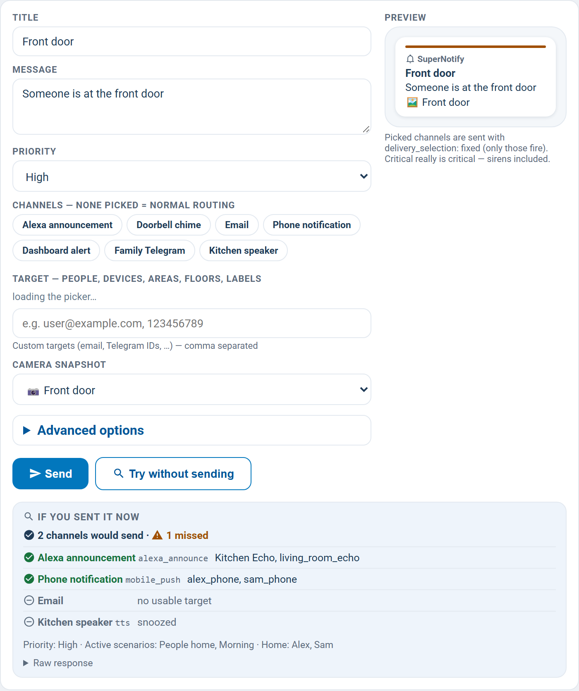
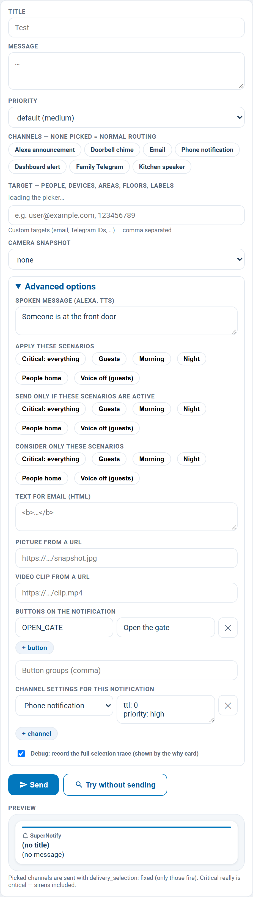

# supernotify-composer-card

[← SuperNotify Cards](../../README.md) · [Common options](../configuration.md)

Try & send: title, message, priority, optional explicit channel chips
(auto-discovered), a native HA **target selector** (people, devices, areas,
floors, labels — the same picker HA itself shows for `supernotify.notify`),
an optional comma-separated **custom targets** field for recipients with no
HA selector (email addresses, Telegram chat IDs, …), camera snapshot picker
and a live phone preview.



Sends via the dedicated `supernotify.notify` action — typed fields instead of
`notify.supernotify`'s generic `data:` — with `delivery_selection: fixed` when
channels are picked, and a confirmation guard on critical priority.

⚠️ **Areas, floors and labels are not resolved by every channel.** SuperNotify
only resolves them natively for transports that call an HA entity service —
`notify_entity`, `alexa_devices`, `html5`, `ntfy`, `kodi`, `media_player`,
`tts` and `chime` (see [issue #9](https://github.com/rhizomatics/supernotify/issues/9)
upstream). With any other channel, or with the default/implicit routing when
no channel is picked, a target made only of areas/floors/labels can silently
end up with no recipient at all. The card shows an inline warning in this
case; pick a compatible channel above (the deliveries card flags them) or add
a person/device directly to the target.

**Try without sending** (🔍): shows which channels would send right now and to
whom, which would be skipped and why, missed channels, priority, scenarios in
force and who is home — without sending anything. It uses SuperNotify's dry
run ([issue #218](https://github.com/rhizomatics/supernotify/issues/218)):
`supernotify.notify` with `dry_run: simulate`. `dry_run: false` hides the button.

The dry run checks duplicates the way a real send would ("duplicate" in the answer means the
real one would be dropped too), and the Send after a try is never held back, because SuperNotify
keeps simulations in a cache of their own. `dry_run_dupe_check: false` skips the check.

**Advanced** (closed by default):

- **Spoken message** — a different text for voice channels (`spoken_message`).
- **Scenarios** — chips to *apply* scenarios to this notification only,
  *require* them (send only if they are active) or *constrain* the channels to
  theirs (`apply_scenarios`, `require_scenarios`, `constrain_scenarios`).
- **Snapshot URL** — a picture by address instead of a camera (`snapshot_url`).
- **Debug** — SuperNotify keeps extra detail on this notification (`debug: true`),
  visible in the why and archive cards.
- **Text for email (HTML)** — `message_html`, for the channels that send HTML.
- **Video clip** — a clip by address (`clip_url`).
- **Buttons** — buttons on the notification, each with its action id and text (`actions`),
  and button groups from your configuration (`action_groups`).
- **Channel settings** — pick a channel and write `key: value` lines: they go to that channel
  for this notification only (`delivery_control: {channel: {data: …}}`), e.g. `ttl: 0`.



```yaml
type: custom:supernotify-composer-card
# dry_run: false              # optional: hide "Try without sending"
# dry_run_dupe_check: false   # optional: skip the duplicate check in the dry run
# show_off: true              # optional: also offer channels switched off or whose transport is off
```
