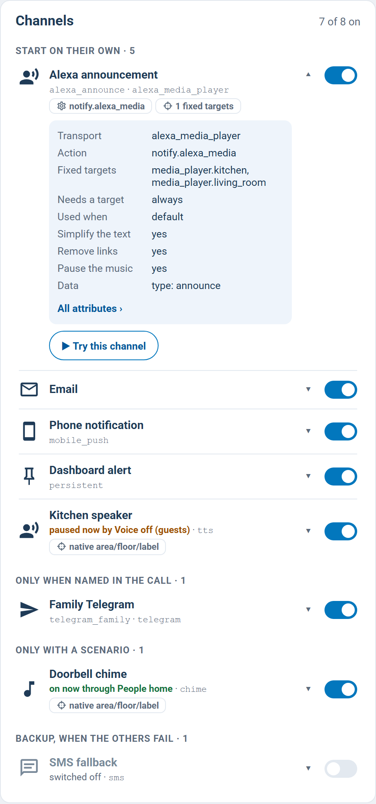

# supernotify-deliveries-card

[← SuperNotify Cards](../../README.md) · [Common options](../configuration.md)

Every channel (delivery) with its on/off switch, auto-discovered from the entities
SuperNotify exposes and grouped by how it starts: **on its own**, **only when named in
the call**, **only with a scenario**, **backup**. The readable name (the delivery's
`alias`) comes first, the technical name small next to it. One status line says what is
going on right now: switched off, transport off, "paused now by <scenario>" when an active
scenario turns it off, "on now through <scenario>" for a scenario-only channel. A "native
area/floor/label" tag marks deliveries whose transport resolves an
area/floor/label target natively (`notify_entity`, `alexa_devices`, `html5`,
`ntfy`, `kodi`, `media_player`, `tts`, `chime`) — see the composer card's
target selector note below for why this matters. **Tap a row** for its detail: transport, action,
fixed targets, when it is used, options in plain words and data, with **All attributes ›**
for Home Assistant's dialog.



```yaml
type: custom:supernotify-deliveries-card
# optional:
hide_defaults: true     # hide auto-generated DEFAULT_* deliveries (default true)
title: Canali           # header text (default "Channels" / "Canali")
group: false            # one flat list instead of the groups (default: grouped)
style: theme
```

To undo the changes made by hand (all, or only channels, transports…) use the
[tools card](tools.md) (0.65.0: the button left this card).

**Try this channel** (0.66.0): in a channel's detail, a dry run through that channel
only - nothing is sent - says whether it would send now and to whom, or why not (snoozed, off,
no usable target…).

**Last send** (0.89.0, SuperNotify 2.14+): each row says how the channel's last send went -
"✔ sent 5 min ago", "✖ failed 21:07" (in red), "⏭ skipped: snoozed" - from `last_outcome`,
`last_sent_at` and `last_skip_reason` on the delivery switch; the detail repeats it as "Last send".
SuperNotify starts these empty after a restart, so a channel shows nothing until it is used again.
A channel whose last send failed is also a red item in the [overview](overview.md) status band and
in the status badge (`ignore:` leaves it out, as for the channels switched off).
