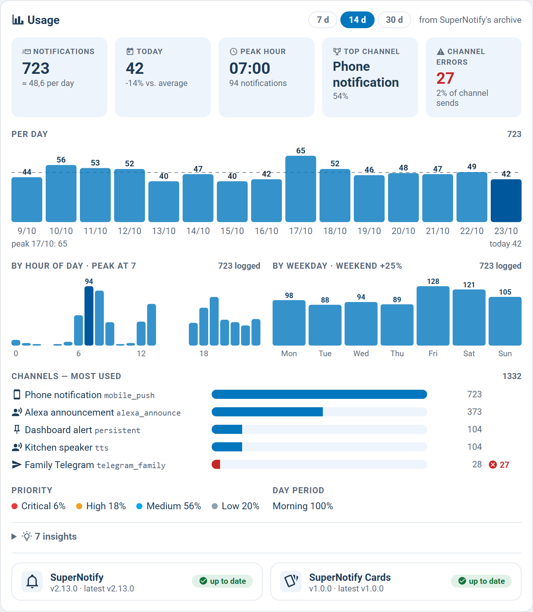

# supernotify-stats-card

[← SuperNotify Cards](../../README.md) · [Common options](../configuration.md)

Usage analytics from SuperNotify's own archive: KPIs (notifications in the window, per day,
today vs. average, peak hour, top channel, channel errors), per-day / per-hour / per-weekday bar
charts, channels most used (with error share), priority and day-period mix, auto-generated insights,
and a version strip showing installed vs. latest version of SuperNotify and of these cards (from the
HACS `update.*` entities, with their brand icon and release link).



Every figure comes from `supernotify.enquire_archive` with `verbosity: daily`: the totals per day of
the whole window in one call of a few KB - no helper, no automation, no utility meter. Duplicates are
left out (nothing was sent). A finished day is kept in this browser and not read again. The band of
the day is the applied scenario named like a band (`period_scenarios`). The figures go back as far as
the archive does (SuperNotify's archive retention).

```yaml
type: custom:supernotify-stats-card
# optional (defaults shown):
days: 14
periods: [7, 14, 30]    # window switch in the header; the choice is remembered per browser
period_scenarios: [early_morning, morning, afternoon, evening, night, late_night]   # scenarios that name the band of the day
update_entity: update.supernotify_update                # HACS update entity
cards_update_entity: update.supernotify_cards_update
refresh_minutes: 10
top_channels: 8
kpis: true              # 0.33.0: false = no number boxes on top; the header then says "Last 30 days · 3864 notifications · ≈ 123 a day"
versions: true          # 0.33.0: false = no version boxes at the bottom (the overview's status band shows them)
grid_options: { columns: full }   # recommended inside a column_span: 2 section
```

From 0.33.0 the busiest day and its dropped duplicates, and today, are written under the daily bars;
the peak hour and the weekend difference are in the titles of their charts, channel errors have a
column of their own, priority and day period are one line of text each, and the insights are folded
("💡 7 insights", tap to open).

**Upgrading from the helpers (before 1.0.0).** `source`, `daily`, `time_entity`, `priority_entity`,
`channels_entity`, `period_entity`, `sent_today_entity` and `count_entity` are gone and ignored: the
"last notification" helpers (`input_datetime.supernotify_last_time`, `input_text.supernotify_last_*`),
the two automations that wrote them and the `supernotify_inviate_oggi` utility meter are no longer read
and can be removed. The rows the card kept in the browser for the day-by-day reading
(`supernotify-stats-archive` in local storage) are deleted the first time 1.0.0 loads.
