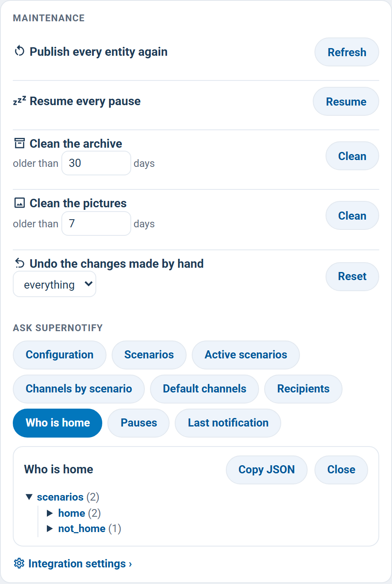

# supernotify-tools-card

[← SuperNotify Cards](../../README.md) · [Common options](../configuration.md)

SuperNotify's maintenance actions and its questions, from the dashboard,
with readable answers. No YAML, no Developer tools.



**Maintenance** — each button shows its result on the same row:

| Row | Action | Result |
| --- | --- | --- |
| Publish every entity again | `supernotify.refresh_entities` | done |
| Resume every pause | `supernotify.clear_snoozes` (not an administrator: `supernotify.unsnooze` on each pause) | how many pauses were resumed |
| Clean the archive older than *N* days | `supernotify.purge_archive` | deleted · left |
| Clean the pictures older than *N* days | `supernotify.purge_media` | deleted · left |
| Undo the changes made by hand (all, scenarios, channels, recipients, transports) | `supernotify.reset_overrides` (not an administrator: the *Reset overrides* button, all only) | what was reset |

The two clean buttons and the reset ask for a second tap within 4 seconds.

**Ask SuperNotify** — one chip per `enquire_*` action (configuration,
scenarios, active scenarios, channels by scenario, default channels,
recipients, who is home, pauses, last notification). The answer opens as a
collapsible tree with **Copy JSON**.

Most of these actions are for administrators in SuperNotify. For anyone else (1.4.0) the card shows
**Refresh**, **Resume every pause** (each pause ended with `supernotify.unsnooze`), **Undo the changes made by
hand** (SuperNotify's *Reset overrides* button: everything at once, without the list of what was put back) and the
enquiries open to everyone, and says in one line that the cleanups, the configuration and the last notification
are for administrators. See [users who are not administrators](../configuration.md#users-who-are-not-administrators).

```yaml
type: custom:supernotify-tools-card
# optional (defaults shown):
archive_days: 30   # starting value of "Clean the archive older than"
media_days: 7      # starting value of "Clean the pictures older than"
```
